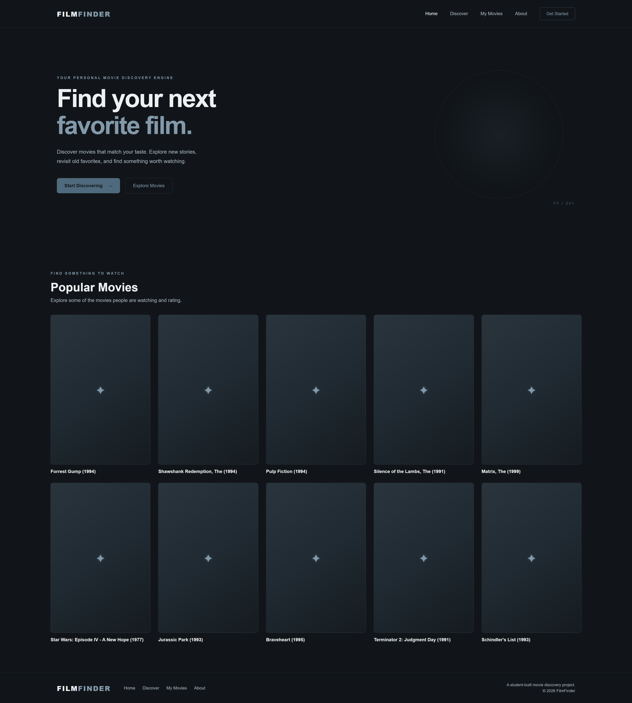
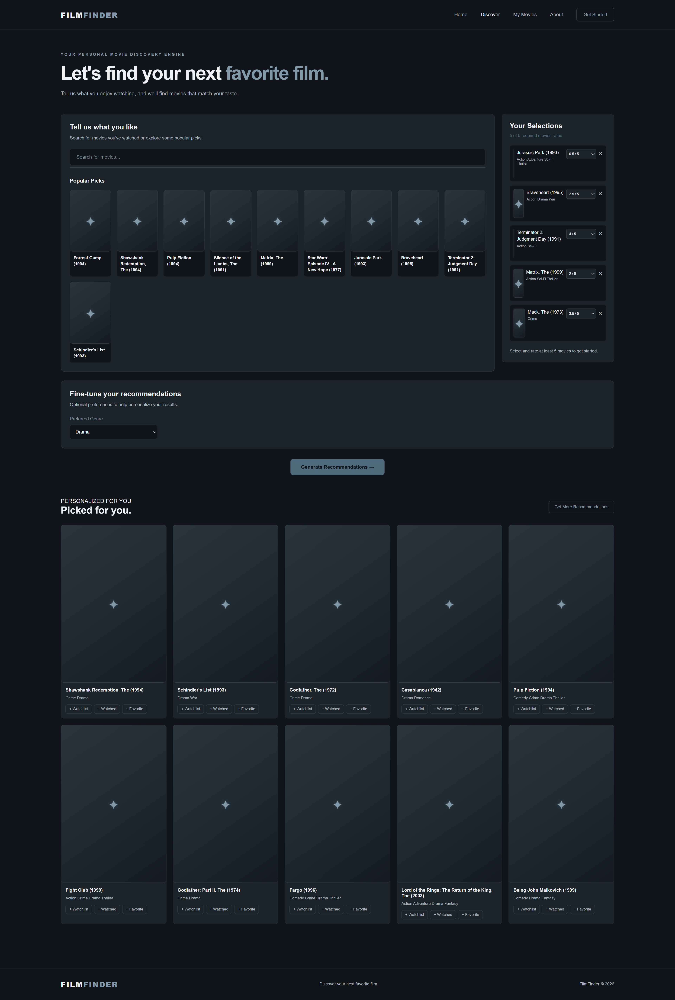

# FilmFinder

*Discover movies. Explore your taste. Find your next favorite.*


FilmFinder is a movie discovery and recommendation web application built with Python, Flask, and machine-learning techniques.

The project combines collaborative filtering and content-based recommendation methods to help users discover movies based on their interests and preferences.

## Features

### Movie Discovery
- Browse and explore movies.
- Search for movies.
- Select and rate movies you've watched.
- Generate personalized movie recommendations.

### Hybrid Recommendation Engine

FilmFinder combines multiple recommendation approaches:

- **Collaborative filtering:** Uses patterns in user ratings to identify movies that users with similar preferences may enjoy.
- **Content-based filtering:** Uses movie metadata and plot descriptions to identify movies with similar characteristics.
- **Hybrid recommendations:** Combines recommendation signals to produce more varied and relevant suggestions.

### My Movies

A personal movie collection featuring:
- Watched movies
- Watchlist
- Favorites
- Collection statistics

Collection information is stored locally in the browser.

## Preview

### Discover Movies


### About FilmFinder


### My Movies


## Technology Stack

| Technology | Purpose |
|---|---|
| Python | Backend development |
| Flask | Web application framework |
| HTML | Page structure |
| CSS | Styling and responsive layouts |
| JavaScript | Frontend functionality |
| Pandas | Data processing |
| NumPy | Numerical operations and embeddings |
| Scikit-learn | Machine-learning utilities |
| Sentence Transformers | Plot embedding generation |
| MovieLens | Ratings and recommendation dataset |
| The Movies Dataset | Additional movie metadata |
| TMDB API | Planned movie information and poster integration |

## Project Structure

```text
FilmFinder/
├── data/
│   ├── links.csv
│   ├── movies.csv
│   ├── movies_metadata.csv
│   ├── plot_embeddings.npy
│   ├── ratings.csv
│   └── tags.csv
├── experiments/
├── src/
│   ├── collaborative.py
│   ├── hybrid.py
│   ├── recommender.py
│   └── __init__.py
├── tests/
├── templates/
├── static/
│   ├── css/
│   └── js/
├── app.py
├── main.py
├── README.md
└── CREDITS.md
```

## Getting Started

### Requirements

- Python 3.13 or a compatible Python version.
- Git.
- The FilmFinder project files.
- The required movie datasets and generated embeddings.

### Installation

Clone the repository:

```bash
git clone https://github.com/YOUR-USERNAME/FilmFinder.git
cd FilmFinder
```

Create a virtual environment:

```bash
python -m venv .venv
```

Activate it on Windows PowerShell:

```powershell
.\.venv\Scripts\Activate.ps1
```

Install dependencies:

```bash
pip install -r requirements.txt
```

> **Note:** The dependency manifest and complete data setup instructions are still being finalized. The supported installation process will be documented here once those details are confirmed.

### Dataset Setup

FilmFinder currently uses the following datasets:

1. **MovieLens — `ml-latest-small`**
   - [GroupLens MovieLens Datasets](https://grouplens.org/datasets/movielens/)

2. **The Movies Dataset**
   - [Kaggle — The Movies Dataset](https://www.kaggle.com/datasets/rounakbanik/the-movies-dataset)

The project also uses `plot_embeddings.npy`, generated from movie plot descriptions using Sentence Transformers.

The required files must be placed in the `data/` directory.

Review `CREDITS.md` for dataset attribution, licensing, and usage conditions before redistributing any data.

### Running FilmFinder

The Flask application is launched through the project's Python entry point.

The exact run command will be documented here once the installation and application startup process has been finalized.

## Recommendation System

FilmFinder explores a hybrid recommendation approach.

### Collaborative Filtering

Collaborative filtering identifies relationships between users and movies using historical rating patterns.

### Content-Based Filtering

Content-based filtering uses movie characteristics and plot descriptions to identify similarities between movies.

### Hybrid Recommendation

The hybrid system combines both approaches to take advantage of their different strengths.

## Privacy

FilmFinder's initial design does not require user accounts.

Movie collection information is stored locally in the browser rather than being associated with a cloud-based personal profile.

## Third-Party Resources and Attribution

FilmFinder uses publicly available movie datasets and open-source software.

Key resources include:

- **MovieLens** — GroupLens Research, University of Minnesota.
- **The Movies Dataset** — Rounak Banik.
- **Sentence Transformers** — Sentence Transformers project.
- **TMDB** — Planned API integration.

Please review [CREDITS.md](CREDITS.md) for detailed attribution, licensing information, and third-party usage requirements.

## Project Status

FilmFinder is under active development.

Current development priorities include:

- Responsive interface improvements.
- Movie poster integration.
- Recommendation engine improvements.
- Reproducible installation and dataset setup.
- Testing and evaluation.
- Future public deployment.

## License

The FilmFinder source code license has not yet been finalized.

Third-party datasets, software, models, and other resources remain subject to their respective licenses and usage conditions. See [CREDITS.md](CREDITS.md).

---

**FilmFinder — Your next favorite movie starts here.**